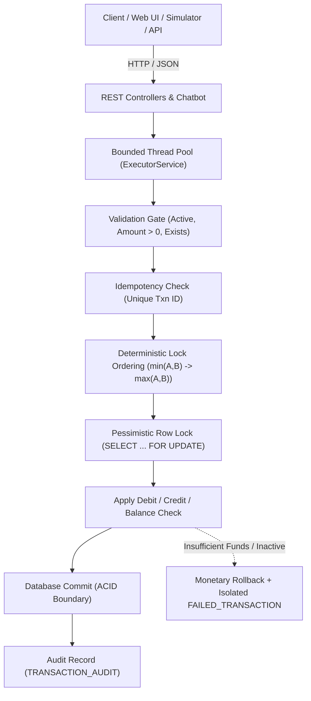
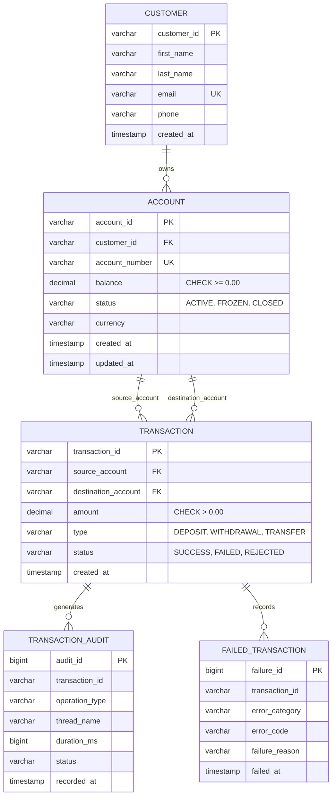

# Multi-Threaded Banking Transaction Processing System

A high-volume, reliable transaction processing engine engineered with **Java 17+ (and Java 21 LTS)**, Spring Boot, Spring Data JPA, HikariCP, and deterministic concurrency control. Backed by PostgreSQL (or embedded H2 in PostgreSQL compatibility mode for zero-configuration execution), featuring an executive Web UI and an autonomous AI Customer Support Assistant.

---

## 🏛️ System Architecture



---

## 📊 Entity-Relationship (ER) Diagram



---

## 💻 How to Open & Run in IntelliJ IDEA

### Step 1: Open Project in IntelliJ IDEA
1. Launch **IntelliJ IDEA**.
2. Click **File -> Open...** (or click **Open** on the Welcome screen).
3. Navigate to:
   ```
   C:\Users\parth\.gemini\antigravity\scratch\bank-transaction-system
   ```
4. Click **OK**.
5. IntelliJ will detect both `pom.xml` and `build.gradle`:
   - If prompted: choose **Open as Project** (select either **Maven** or **Gradle**). Both are fully supported!

### Step 2: Configure Project SDK
1. Go to **File -> Project Structure... -> Project**.
2. Set **SDK** to **Java 17** or **Java 21** (e.g. your installed OpenJDK 21).
3. Set **Language Level** to **SDK Default** (or **17+**).
4. Click **Apply** and **OK**.

### Step 3: Run the Application
1. In the Project Explorer, expand:
   `src/main/java/com/bank/transaction/BankTransactionApplication.java`
2. Right-click on `BankTransactionApplication` and select **Run 'BankTransactionApplication.main()'** (or press `Shift + F10`).
3. You will see the Spring Boot banner and HikariCP connection pool initialize on port `8080`.

### Step 4: Open the Web UI Dashboard
Open your browser and navigate to:
```
http://localhost:8080
```

---

## ⚡ Key Demonstration Scenarios

### 1. Mandatory Concurrency Scenario (Evaluation Gate)
- **Problem**: Account `ACC1001` has ₹10,000. Simultaneous withdrawals of ₹7,000 and ₹5,000 arrive concurrently from separate threads.
- **Requirement**: Both must **NOT** succeed. Exactly one must succeed, leaving a valid non-negative balance (₹3,000 or ₹5,000). The other must be rejected with `InsufficientBalanceException`.
- **How to test**:
  - In the Web UI: Click the **⚡ Mandatory Concurrency Test** tab and hit **Fire Simultaneous Concurrency Test Now**.
  - In IntelliJ: Run the automated test in `src/test/java/com/bank/transaction/MandatoryConcurrencyTest.java`.

### 2. Idempotency Test
- Repeating a request with the same `transactionId` is rejected with `DuplicateTransactionException` without updating balances a second time.
- Automated test: `src/test/java/com/bank/transaction/IdempotencyTest.java`.

### 3. Deadlock-Free Bidirectional Transfers
- Thread 1 transfers ₹100 from ACC1001 -> ACC2004, while Thread 2 simultaneously transfers ₹100 from ACC2004 -> ACC1001.
- Deterministic locking order (locking the lower account ID first) eliminates deadlocks completely.
- Automated test: `src/test/java/com/bank/transaction/TransferDeadlockTest.java`.

### 4. 50,000+ Transaction Performance Benchmark
- Navigate to the **🚀 50,000+ Benchmark Suite** tab in the UI.
- Select workload (1,000, 10,000, or 50,000) and click **Run Performance Test Suite**.
- Compares **1, 5, 10, and 20 worker threads** measuring Total Time, TPS (transactions per second), and DB bottlenecks.

### 5. 5 SQL Analytical Reports with `EXPLAIN` Query Plans
- Navigate to the **📊 SQL Reports & EXPLAIN** tab to review:
  1. Top 10 accounts by transaction volume
  2. Failed transactions grouped by reason
  3. Daily transaction amount by transaction type
  4. Accounts with more than N transactions
  5. Complete transaction history for a customer

### 6. AI Customer Support Chatbot
- Click the **💬** bubble in the bottom right corner of the UI.
- Ask questions like:
  - *"What is the balance of ACC1001?"*
  - *"What is the status of TXN-INIT-001?"*
  - *"Why did my transaction fail?"*
  - *"How does concurrency prevent race conditions?"*

---

## 📂 Project Directory Structure

```
bank-transaction-system/
├── build.gradle
├── pom.xml
├── settings.gradle
├── DESIGN_NOTE.md
├── README.md
└── src/
    ├── main/
    │   ├── java/com/bank/transaction/
    │   │   ├── BankTransactionApplication.java
    │   │   ├── config/AsyncThreadPoolConfig.java
    │   │   ├── controller/
    │   │   │   ├── AccountController.java
    │   │   │   ├── BenchmarkController.java
    │   │   │   ├── ChatbotController.java
    │   │   │   ├── ConcurrencyController.java
    │   │   │   ├── ReportController.java
    │   │   │   └── TransactionController.java
    │   │   ├── dto/
    │   │   ├── exception/
    │   │   ├── model/
    │   │   ├── repository/
    │   │   └── service/
    │   │       ├── AccountLockManager.java
    │   │       ├── AuditService.java
    │   │       ├── BenchmarkService.java
    │   │       ├── ChatbotService.java
    │   │       ├── ConcurrencyEngine.java
    │   │       ├── ReportingService.java
    │   │       ├── TransactionService.java
    │   │       └── ValidationService.java
    │   └── resources/
    │       ├── application.yml
    │       ├── application-postgres.yml
    │       ├── db/
    │       │   ├── schema.sql
    │       │   └── seed.sql
    │       └── static/
    │           ├── index.html
    │           ├── css/styles.css
    │           └── js/app.js
    └── test/
        └── java/com/bank/transaction/
            ├── IdempotencyTest.java
            ├── MandatoryConcurrencyTest.java
            └── TransferDeadlockTest.java
```
